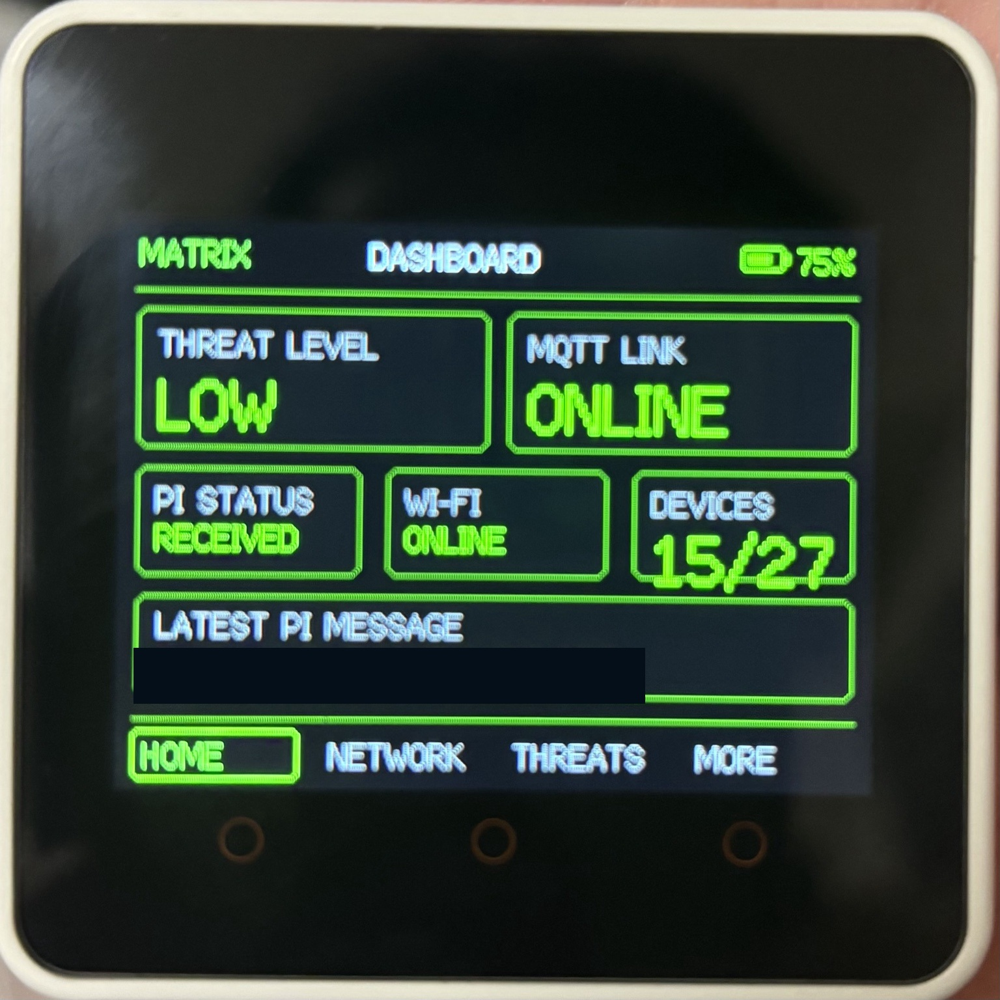
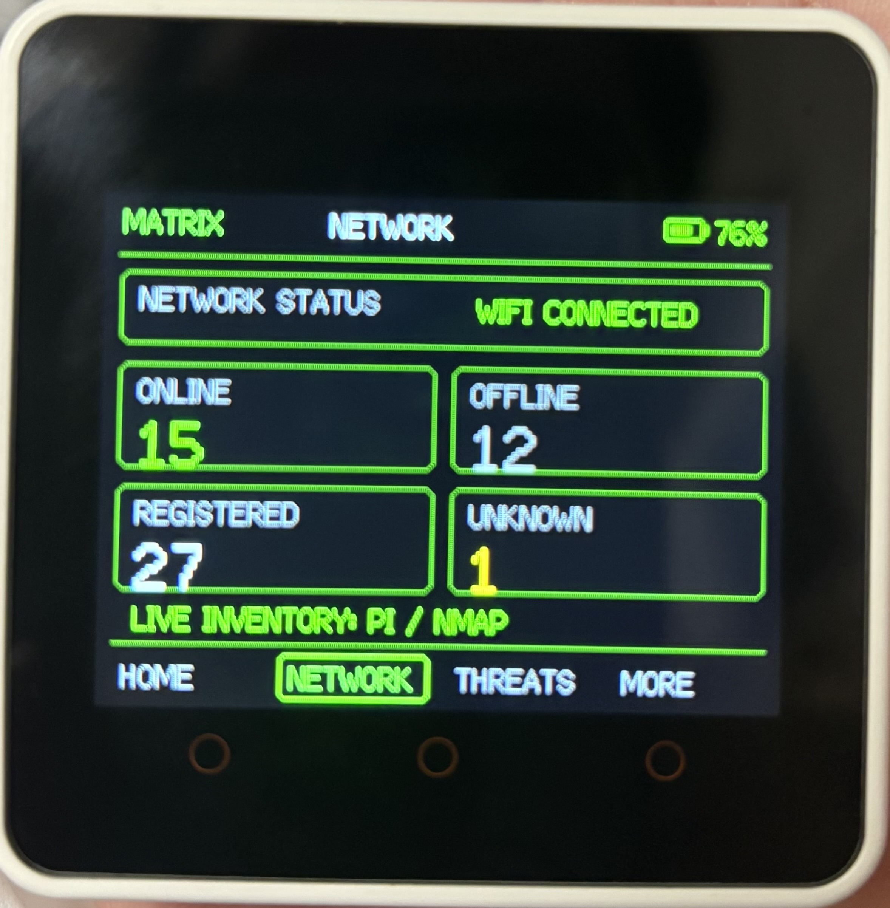
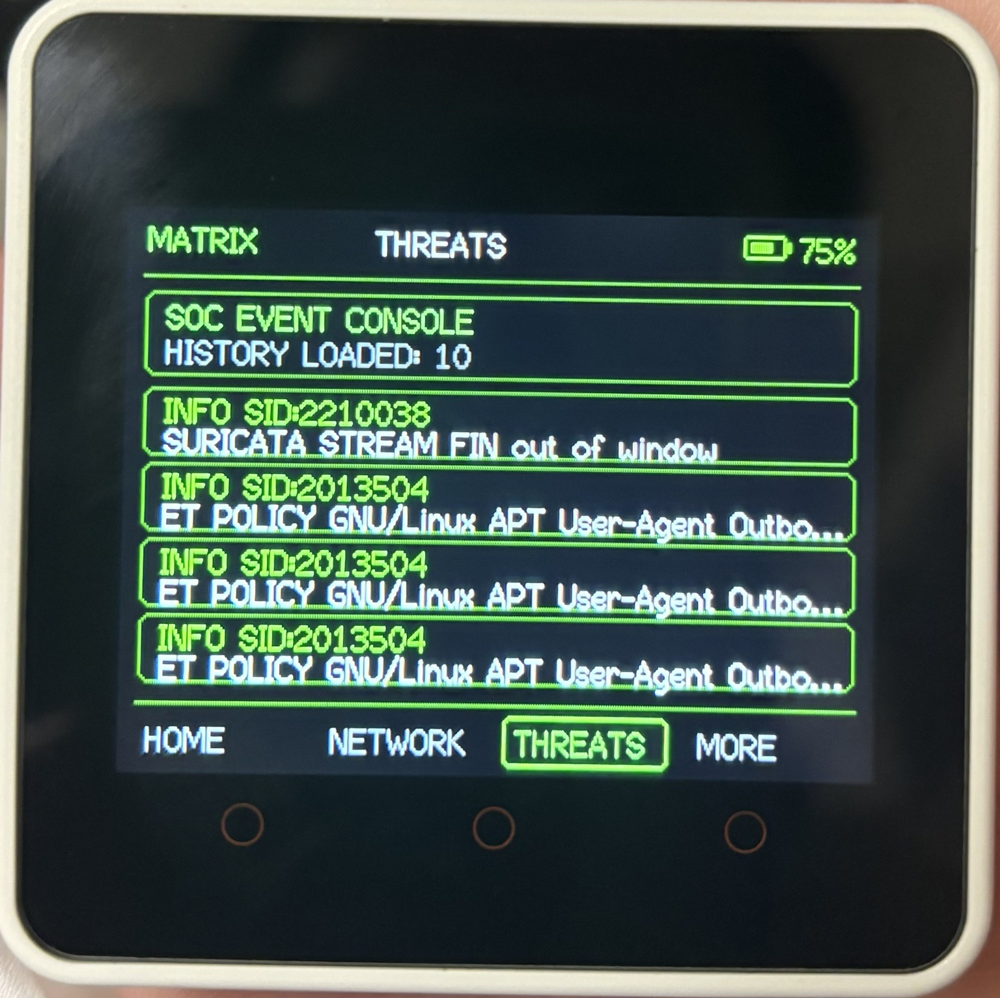
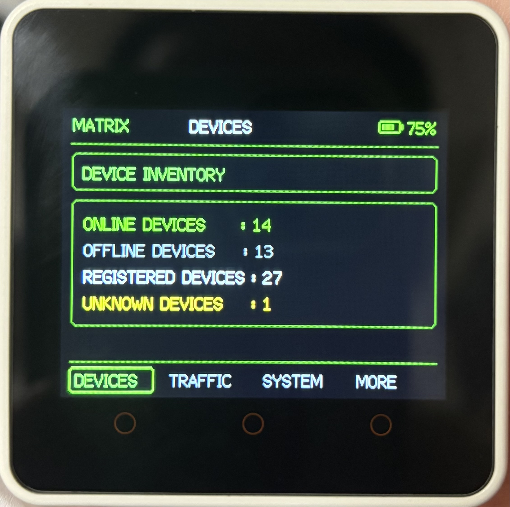
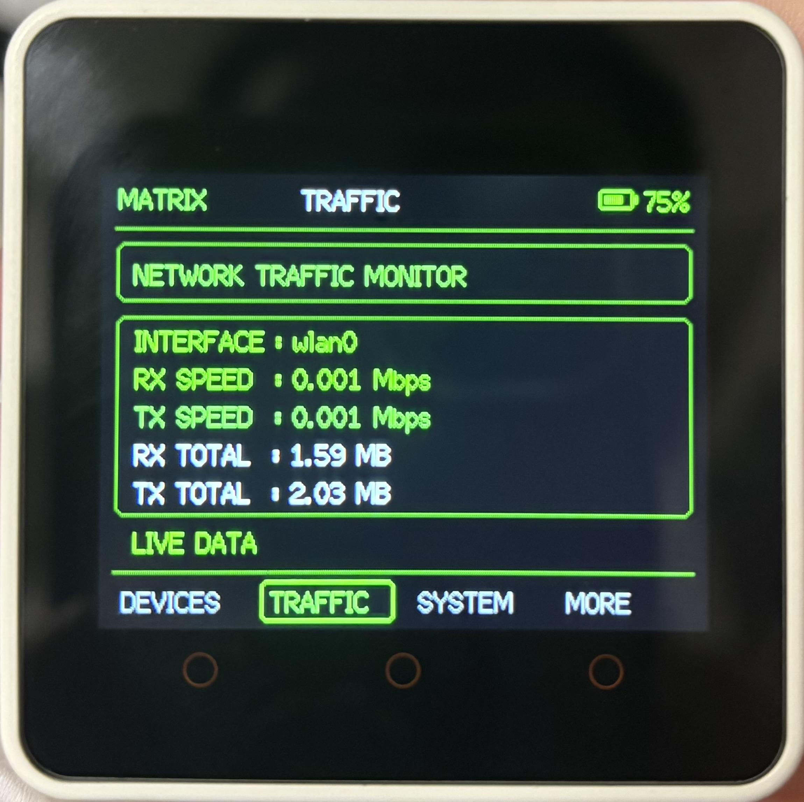
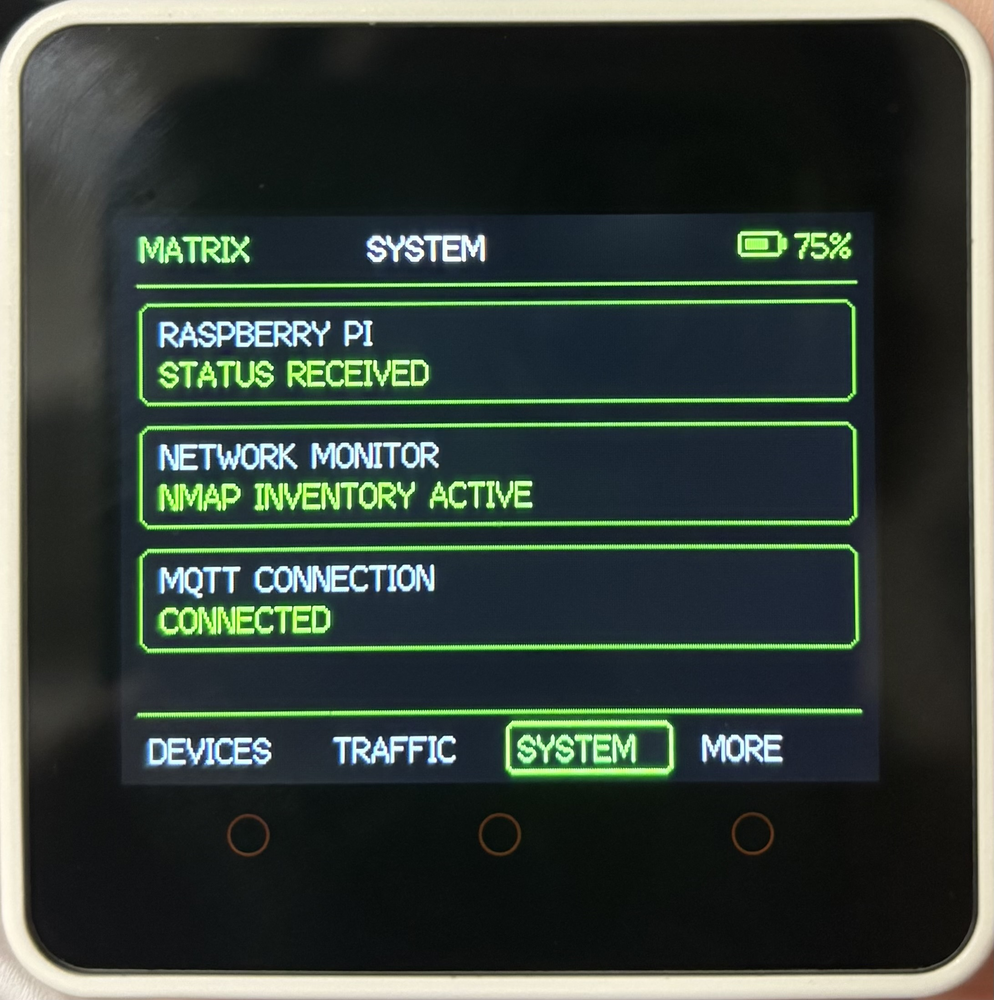
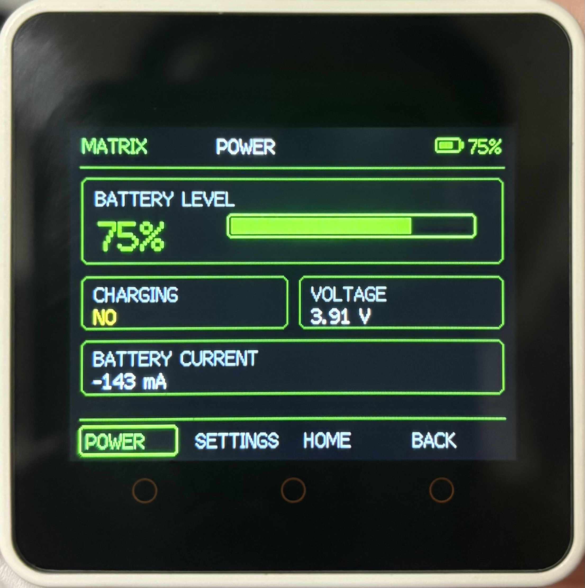
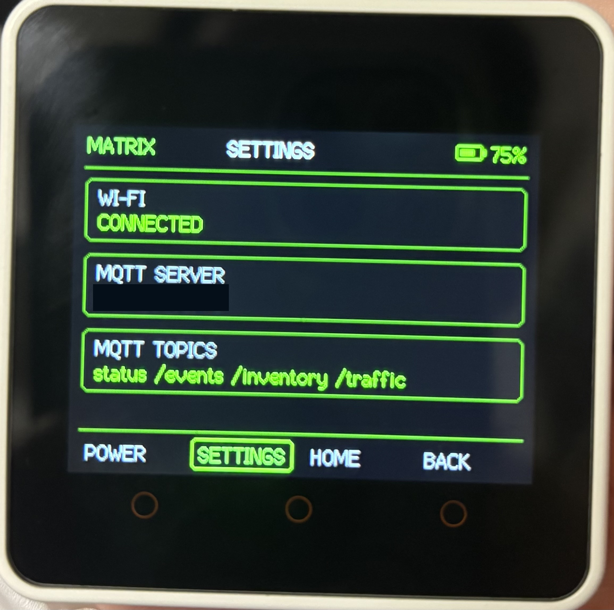

# MATRIX HOME SOC

**A Raspberry Pi 3 and M5Stack Core2-based home network security monitoring system.**

MATRIX HOME SOC is a self-hosted home network security monitoring system that integrates network device discovery, intrusion detection, event collection, traffic monitoring, and real-time visualization.

The system uses a Raspberry Pi 3 as its monitoring server and an M5Stack Core2 as a dedicated security dashboard.

It combines open-source security tools and custom-developed software to provide practical visibility into home network activity.

## Overview

MATRIX HOME SOC was designed to bring essential Security Operations Center (SOC) capabilities into a home network environment using affordable hardware and open-source software.

The system provides:

- Network device discovery and inventory management
- Intrusion Detection System (IDS) monitoring with Suricata
- Security event collection and storage using SQLite
- MQTT-based communication between components
- Network traffic monitoring and visualization
- Real-time security dashboard on M5Stack Core2
- Threat event history
- Automatic service startup and recovery

## Features

### Network Device Discovery

- Network discovery using Nmap
- Automatic device detection
- Device inventory management
- Detection of newly discovered devices
- Periodic network scanning

### Intrusion Detection

- Suricata IDS integration
- Security event collection
- Detection event processing through a custom bridge
- Threat event storage
- Threat history visualization

### Network Traffic Monitoring

- Network interface traffic monitoring
- RX/TX traffic measurement
- Real-time traffic visualization
- Traffic statistics collection

### Event Management

- SQLite-based event storage
- Security event history
- Device inventory storage
- MQTT-based event distribution

### M5Stack Security Dashboard

The M5Stack Core2 provides an eight-page dashboard for monitoring network status and security events.

## Dashboard Screenshots

The MATRIX HOME SOC dashboard runs on an M5Stack Core2 and provides eight dedicated screens for monitoring network status, connected devices, threats, system health, and traffic.

### HOME



### NETWORK



### THREATS



### DEVICES



### TRAFFIC



### SYSTEM



### POWER



### SETTINGS



## System Architecture

```text
                    Home Network
                         |
                         |
                  Raspberry Pi 3
                         |
        +----------------+----------------+
        |                |                |
      Nmap            Suricata       Traffic Monitor
        |                |                |
        |          Suricata Bridge        |
        |                |                |
        +----------------+----------------+
                         |
                    SQLite Database
                         |
                    MQTT Broker
                         |
                         |
                  M5Stack Core2
                         |
                 Security Dashboard
```

## Technology Stack

| Component | Technology |
|---|---|
| Monitoring Server | Raspberry Pi 3 |
| Operating System | Ubuntu 22.04 |
| Network Discovery | Nmap |
| Intrusion Detection | Suricata |
| Message Broker | Mosquitto MQTT |
| Database | SQLite |
| Backend | Python 3 |
| Device Dashboard | M5Stack Core2 |
| Dashboard Development | Arduino / M5Stack |
| Service Management | systemd |

## M5Stack Dashboard

The M5Stack Core2 provides the following eight screens:

| Screen | Description |
|---|---|
| HOME | Overall security monitoring status |
| NETWORK | Network status and device information |
| THREATS | Security alerts and threat history |
| SYSTEM | Monitoring server status |
| DEVICES | Discovered network devices |
| TRAFFIC | Network traffic visualization |
| POWER | Power and battery information |
| SETTINGS | Dashboard configuration |

The dashboard uses a custom Matrix-inspired black and neon-green interface.

The display is implemented using M5Canvas double buffering to provide smooth screen updates.

## MQTT Topics

The system uses MQTT for communication between the Raspberry Pi monitoring components and the M5Stack dashboard.

| Topic | Purpose |
|---|---|
| `matrix/status` | Overall monitoring status |
| `matrix/events` | System events |
| `matrix/inventory` | Network device inventory |
| `matrix/requests/threats` | Threat-related requests |
| `matrix/threats/history` | Threat event history |
| `matrix/traffic` | Network traffic statistics |

## Database

SQLite is used to store monitoring data and security events.

The database schema is provided in:

`database/matrix_schema.sql`

The database stores information used by the monitoring system, including device inventory and security event records.

## Repository Structure

```text
matrix-home-soc/
├── app/
│   ├── matrix_monitor.py
│   ├── matrix_traffic.py
│   └── suricata_bridge.py
├── config/
│   ├── monitor.example.json
│   └── suricata.yaml.example
├── database/
│   └── matrix_schema.sql
├── docs/
│   ├── images/
│   │   ├── dashboard.jpg
│   │   ├── network.jpg
│   │   ├── threats.jpg
│   │   ├── devices.jpg
│   │   ├── traffic.jpg
│   │   ├── system.jpg
│   │   ├── power.jpg
│   │   └── settings.jpg
│   ├── INSTALLATION.md
│   ├── OPERATIONS.md
│   ├── ARCHITECTURE.md
│   └── SECURITY.md
├── m5stack/
│   └── matrix_home_soc/
│       ├── matrix_home_soc.ino
│       └── secrets.example.h
├── systemd/
│   ├── matrix-home-soc.service
│   ├── matrix-suricata-bridge.service
│   └── matrix-traffic.service
├── .gitignore
├── README.md
└── requirements.txt
```

## Installation

Detailed installation and configuration instructions are available in:

- [Installation Guide](docs/INSTALLATION.md)
- [Operations Guide](docs/OPERATIONS.md)
- [Architecture](docs/ARCHITECTURE.md)
- [Security Considerations](docs/SECURITY.md)

The repository includes example configuration files and systemd service definitions.

Before deployment, configure the environment-specific settings and credentials.

## Operation

The monitoring components are managed as Linux systemd services.

The system includes services for:

- Main network monitoring
- Suricata event processing
- Network traffic monitoring

The services are configured to start automatically and support recovery after service failures.

Refer to the [Operations Guide](docs/OPERATIONS.md) for operational details.

## Monitoring Scope and Limitations

MATRIX HOME SOC is designed for practical home network monitoring.

**Important monitoring limitation:**

When the Raspberry Pi is connected to a normal Wi-Fi network, it can monitor traffic visible to its own network interface, but it cannot necessarily inspect all unicast traffic exchanged directly between other devices on the same LAN.

For full visibility into traffic between other LAN devices, additional network infrastructure such as a managed switch with port mirroring or a network TAP would be required.

This functionality is outside the current project scope.

The system should therefore be understood as a practical home network monitoring solution, not as a complete network-wide packet inspection platform.

## Security Considerations

- Do not commit passwords, API keys, private keys, or other credentials.
- Keep environment-specific configuration files out of version control.
- Use the provided example configuration files as templates.
- Review [Security Considerations](docs/SECURITY.md) before deployment.

## Project Goals

The goal of MATRIX HOME SOC is to demonstrate how affordable hardware and open-source technologies can be combined to build a practical home network security monitoring environment.

This project includes both system integration and custom software development, covering network discovery, IDS integration, event processing, database management, traffic monitoring, and embedded dashboard development.

## Author

**Ryo Imaoka**

Cybersecurity Engineer

GitHub: [@ryoimaoka](https://github.com/ryoimaoka)

## Disclaimer

This project is intended for educational, research, and authorized defensive security monitoring purposes.

Use it only on networks and devices that you own or are authorized to monitor.
